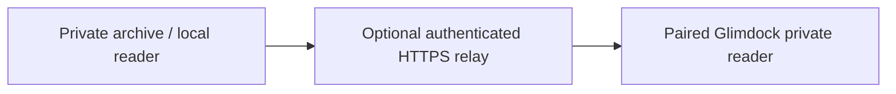

# Private conversations on Glimdock

The optional private reader opens your authorized conversation archive from
**Settings → Private conversations**. It is separate from hardware telemetry
and the `agent-ops/v1` monitoring feed. Conversation text, titles and archive
credentials do not belong in either public feed.

This guide describes the current `private-chat/v1` client and
`private-chat-pairing/v1` USB helper. Use firmware containing the private-reader
modules. Relay deployment and archive collection use your own implementation's
documented setup; the USB helper provisions an existing relay connection.

## Connection and storage



The display connects to a fixed HTTPS relay origin with a dedicated device
credential. The current transport requires a **literal IPv4 address** rather
than a DNS name or IPv6 address. Its certificate must identify that IP address
in its subject alternative names and chain to the paired CA certificate.
The display needs a synchronized clock before it can verify certificate dates
and open the reader. It sends the credential in an `Authorization: Bearer …`
header and rejects redirects. Keep the original archive key and local reader
credential with the archive service; issue a separate credential for each display.

| Data | On the ESP32 |
| --- | --- |
| Device identity, relay origin, device credential and CA certificate | Saved in the separate `privateChat` NVS namespace |
| Current session/message page, title, cursor and message text | Held in the dedicated private-reader RAM model |
| Hardware and agent monitoring snapshots | Remain separate from private conversation pages |

Leaving the private view clears the private page model, visible label buffers
and pending request state.
A request generation check prevents an earlier response from repopulating an
exited or changed view. HTTP response and parser buffers are wiped after use.
Pairing remains available for the next visit; clearing a displayed conversation
does not revoke the device credential.

NVS storage is persistent and does not by itself provide flash encryption. Treat
the paired display and its USB connection as access to your private reader.
Manage device-credential revocation through your relay's administrative interface.

## Pair over USB

Obtain a device-specific pairing file from your relay administrator. Store it
outside the source checkout and release directories, owned by your local user,
with file mode **0600**. The helper requires an absolute path to a regular file
and rejects symlinked files or parent directories.

The file contains exactly these fields:

| Field | Requirement |
| --- | --- |
| `schema_version` | `private-chat-pairing/v1` |
| `device_id` | 1–64 printable ASCII characters, without whitespace |
| `relay_url` | Literal IPv4 HTTPS origin, at most 256 characters; optional port; no credentials, query, fragment or path beyond `/` |
| `device_token` | Device-only credential, 24–256 printable ASCII characters without whitespace |
| `ca_pem` | Valid PEM certificate or certificate chain, at most 8 KiB; no private key |

The JSON file is bounded to 16 KiB. Duplicate keys, missing fields and extra
fields are rejected. The firmware retains its own independent field and
certificate validation.

Connect the supported display with a USB data cable, close any serial monitor
using its port, and run the helper from the source checkout. Python needs
`pyserial` for the physical UART transport.

```sh
python3 tools/provision-private-reader.py \
  --credentials-file /PRIVATE/STATE/private-chat-pairing.json \
  --port /dev/ttyACM0
```

The file and USB port above are placeholders. Use the actual port for your
computer, and keep the file path private. Pass credentials through the restricted
file, never as command-line token arguments, URLs or pasted console output.

The helper opens the UART at 115200 baud with inactive DTR/RTS control lines. It
sends a bounded `GLIMDOCK_PRIVATE_READER` frame with a random nonce and accepts
only the matching success acknowledgment. It does not request a reboot or alter
the existing Wi-Fi/collector pairing. USB provisioning transfers the credential
over the physical serial connection; do not record the raw transfer.

The CLI prints only `Private reader provisioned.` or a generic failure message.
It does not print the file contents, credential, relay response or exception
details. A successful acknowledgment confirms saved pairing, not successful
archive access. Open the private view to check the connection.

## Read pages on the display

Open **Settings → Private conversations**, select a session, then read its
visible user/assistant messages. The display requests at most **12 sessions**
or **5 messages** per page. Follow the supplied pagination controls to request
another bounded page.

A long message is continued using its message order and the relay's returned
text offset. Pass the returned offset unchanged; do not infer offsets from
displayed byte length. Each returned text chunk must fit within **4096 UTF-8
bytes**. Only the current page and chunk need to be present on the device.

Unavailable, malformed or unauthorized responses show a generic reader error.
An unpaired display cannot access the relay. Relay failure leaves the existing
hardware and agent monitoring views available.

## Relay interface: `private-chat/v1`

The current device uses these read requests at the paired HTTPS origin:

| Request | Purpose |
| --- | --- |
| `GET /v1/conversations?limit=12` | First session page |
| `GET /v1/conversations?limit=12&cursor=CURSOR` | Next session page |
| `GET /v1/conversations/SESSION_ID/messages?limit=5` | First message page |
| `GET /v1/conversations/SESSION_ID/messages?limit=5&after=ORDER` | Continue from returned `next_after` |
| `GET /v1/conversations/SESSION_ID/messages?limit=5&message_order=ORDER&text_offset=OFFSET` | Continue a long message |

Authentication belongs in the Bearer header, never the query string. Session IDs
are opaque 64-character lowercase hexadecimal values. Pagination cursors are
opaque URL-safe tokens, at most 512 characters. Responses must use HTTP 200,
`application/json` and a positive `Content-Length` no larger than **48 KiB**;
the current client rejects responses with an unknown body length.
HTTP headers are limited to **4 KiB**. Header and body reception share a
**2-second deadline** after the request is sent. Chunked transfer and compressed
bodies are rejected; serve the bounded JSON directly with its exact length.

Both response forms declare `schema_version: "private-chat/v1"`. A session page
contains `items`, `total`, `has_more` and `next_cursor`. Each item includes an
opaque `id` and optional display metadata such as `title`, `provider`, `machine`,
`project`, `started_at`, `last_message_at` and `message_count`.

A message page contains `session`, `messages`, `total`, `has_more` and
`next_after`. Each message has an increasing, nonnegative `order`, role `user`
or `assistant`, text, and optional timestamp. `text_offset`, `text_characters`
and `next_text_offset` describe continuation; `null` means unavailable or no
further continuation where applicable. Dates are numeric Unix timestamps or
`null`; a missing date is not invented.

This synthetic response illustrates the message shape. It is not archive data:

```json
{
  "schema_version": "private-chat/v1",
  "demo": true,
  "session": {
    "id": "aaaaaaaaaaaaaaaaaaaaaaaaaaaaaaaaaaaaaaaaaaaaaaaaaaaaaaaaaaaaaaaa",
    "title": "Synthetic conversation",
    "provider": "sample-provider",
    "machine": "sample-machine"
  },
  "messages": [
    {
      "id": "sample-message",
      "order": 0,
      "role": "assistant",
      "timestamp": null,
      "text": "Synthetic message only.",
      "text_offset": 0,
      "text_characters": 23,
      "next_text_offset": null
    }
  ],
  "total": 1,
  "has_more": false,
  "next_after": 0
}
```

The ESP32 rejects oversized collections, duplicate session identities, invalid
UTF-8, unsupported roles, invalid IDs/cursors and non-increasing message order.
Display labels may be visibly shortened; message text must fit exactly within
the returned chunk. Source redaction remains the archive/relay's responsibility.
The display renders text as inert content and provides no execution or approval
controls.

## Public builds and verification

Public source, firmware, examples and update bundles contain no private pairing
file, reader key or conversation data. The native/WebAssembly test transport is
fixture-only and accepts explicitly synthetic (`demo: true`) private pages.
It does not read NVS, private files or a real relay.

The USB helper has a synthetic test suite that needs no archive or connected
device:

```sh
python3 tools/test-provision-private-reader.py
```

For integration changes, use synthetic sessions and messages to verify page
limits, long-text continuation, malformed/oversized responses, stale-response
rejection and cleanup on exit. Keep real messages, titles, authenticated reader
URLs, credentials, provisioning files and flash dumps out of test artifacts,
screenshots, coordination messages and public releases.

Implementation references:

- [USB provision helper](../tools/provision-private-reader.py)
- [Private reader model](../firmware/src/private_chat_model.h)
- [Bounded decoder](../firmware/src/private_chat_parse.h)
- [Private transport and lifecycle](../firmware/src/private_chat_network.cpp)
