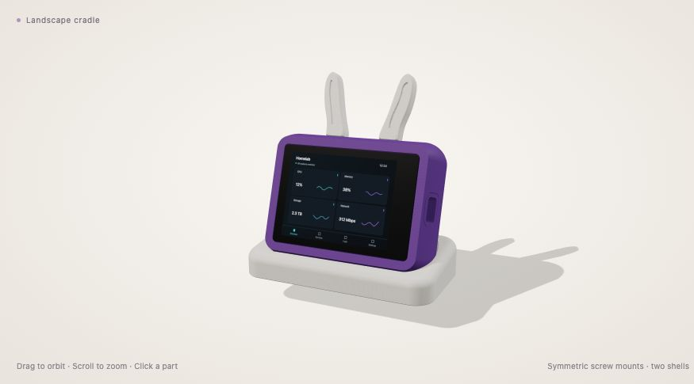

# Portable r45 enclosure

The current Glimdock enclosure is a removable purple display pod with separate
white landscape and portrait desk stands. The pod contains the display, battery
space and two speakers. The stands are passive supports. A full rear shell
closes the pod; there is no separate battery hatch.

Rendered from the released geometry with synthetic display content.

This is the curated current design snapshot, dated 30 October 2026. It contains
the selected final files from the r45 work, rather than its development trials.
It remains a prototype: nominal CAD and toolpath checks do not establish every
printed fit, surface finish, battery configuration or long-term durability.

## Downloads

| Folder | Contents |
| --- | --- |
| `cad/` | Editable STEP/BREP parts and the original enclosure-parts assembly. |
| `stl/` | The 23 current printable parts in the documented print frames. |
| `assembly/` | Meshes for the interactive assembly, including portrait accessory poses. |
| `print-projects/` | Portable OrcaSlicer layouts containing current geometry and authored process settings. |
| `viewer/` | Self-contained interactive assembly with synthetic screen data. |
| `tools/` | Portable export tools for the included direct-edit CAD. |
| `parts.json` | Part inventory, dimensions, coordinate frames and fit limits. |
| `manifest.json`, `SHA256SUMS` | File inventory and integrity hashes. |

Open [the interactive viewer](viewer/index.html) through a static web server.
For example, run `python3 -m http.server 8000` from this directory and open the
viewer on that local server. It does not connect to a printer or a live collector.

STEP and BREP are the editable CAD source for this snapshot. They retain analytic
solids and surfaces for direct editing, but not the original parametric feature
history. The assembly includes original enclosure parts only. Manufacturer PCB
CAD is excluded; any hardware envelopes in the viewer are generic dimensional
illustrations.

## Current parts

The release includes the repaired front and its matching USB-C tunnel, the
symmetric rear shell, two display-carrier rails, the fixed battery tray, the
one-piece BAT_PWR button with glue tabs, four rear screw caps, two passive
stands, and ten interchangeable accessory parts.

Use the matching front and USB tunnel together. The current carrier is two
separate rails. The landscape stand has a continuous exterior front and a hidden
upward-open button well. Lift the pod from its stand if needed to reach BAT_PWR.

The accessories are two 6 mm bunny ears, two TV antennas, two eyes and four
curved socket plugs. The same ornament pair can be moved between landscape and
portrait sockets; the extra portrait assembly meshes are display poses, not
additional parts to print. Fuller keyed stems with shallow tapered grip ribs
replace the earlier loose, slotted mounts. Their physical holding force and
wear remain to be checked. The ornament shoulders leave a small rear cosmetic
seat clearance; the four blank plugs follow the curved outer surface.

## Printing

Select your own printer, nozzle and filament before slicing a public project.
These are portable layouts, not machine-ready G-code. They contain no printer
connection, vendor machine preset, start/end macro or saved calibration data.
Extracted layouts and any newly exported poses must be sliced and reviewed on
the selected setup.

The source print work used PLA and a 0.4 mm nozzle. Most parts used 0.12 mm
layers with a 0.20 mm first layer, a 55°C bed, 20 mm/s outer walls and
500 mm/s² acceleration. The small button uses a finer layer setting. See the
[print-project notes](print-projects/README.md) for each layout's retained
settings and support requirements.

The latest ten-accessory layout has an 8 mm outside brim on every piece and
no supports. Remove brim traces from the fitting edges before assembly. Keep
glass seats, screw bores, the USB passage and accessory fitting surfaces clear
of support remnants. Nominally flat CAD does not guarantee bed adhesion or
freedom from corner warping.

## Assembly

The front and rear use a centered 71 × 50 mm screw pattern and a nominal
0.25 mm perimeter seam. Four M3 × 12 countersunk machine screws fasten the rear
to the front's heat-set inserts. Fit the actual inserts to the printed pilots
before installing electronics.

Seat the display without pressure on the glass, PCB, ribbon or USB socket.
Install the two carrier rails using four M2.5 × 6 countersunk **machine** screws
in the display's factory posts and two M3 × 12 countersunk screws at the carrier
anchors. Pointed coarse-thread screws do not belong in the factory metal posts.
The rails are named as seen from the screen; the open rear view reverses left
and right. Follow [the assembly guide](ASSEMBLY.md) for the insertion
sequence, and stop if a rail loads the board before seating.

The current BAT_PWR button is one piece with small return springs and fixed
inside-wall glue tabs. Temporarily remove the electronics to install it. Dry-fit
the pad, actuator and return movement before bonding only the fixed tabs; keep
glue off the springs and switch. The switch must release freely.

The battery tray is fixed to the rear's central land. Provide padding, a soft
strap and lead slack. The measured battery envelope is 60.5 × 50.2 × 7.4 mm;
each measured speaker is 30 × 20 × 4.7 mm. These measurements do not identify
an interchangeable battery product. Confirm electrical compatibility, connector
polarity and charging configuration against the actual board and pack before
battery operation. Mechanical space alone does not qualify the electrical setup.

## Validation and license

The selected front/tunnel, carrier, closed-front stand and accessories have
recorded nominal CAD checks. The original reviewed print jobs used local machine
settings that are deliberately absent here. The public files preserve the
selected geometry and document their frames; they are not a certification of
complete assembly, support removal, spring life, print finish or battery safety.
The portrait stand's setup and physical fit need their own review.

Original geometry uses **CERN-OHL-P-2.0**. Original viewer code, documentation,
metadata and generic tools use **MIT**. The vendor viewer library retains its
own notices. See [LICENSE](LICENSE), `LICENSES/` and adjacent asset notices.
